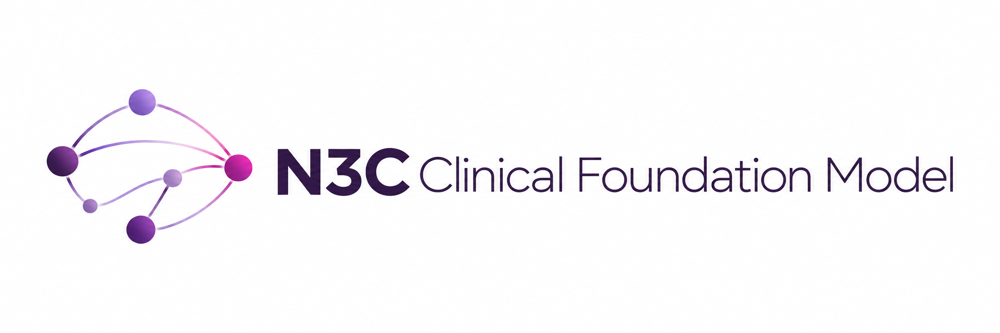
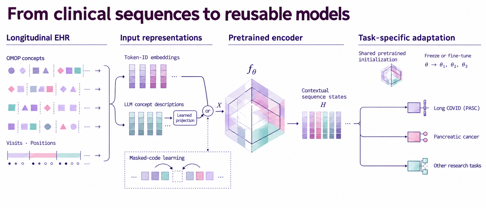

<p align="center">
  
</p>

<h3 align="center">Trained on 16M patients from the N3C enclave</h3>

## Overview

A patient's medical history contains patterns that unfold across years of diagnoses, medications, procedures, and laboratory measurements. Our project develops **clinical foundation models that learn from these longitudinal histories**, creating reusable representations for clinical research and disease prediction.

Built within the **National Clinical Cohort Collaborative (N3C)** enclave, the project brings together large-scale clinical data, standardized medical concepts, and advances in representation learning. Researchers can adapt a pretrained model to their own prediction tasks, building on patterns learned across a broad patient population.

The **N3C-pretrained 16M MedEncoder has been externally evaluated for Long COVID prediction in the All of Us cohort, outperforming the evaluated non-foundation-model baselines**.

**Release status:** The [All of Us reference implementation](https://github.com/ClinicalFM/N3CFM), covering cohort conversion, downstream fine-tuning, and modeling results, is planned for a future release. Quick Flow below previews its usage.

## Quick Flow

**Labeled cohort → Patient sequences → Fine-tuning → Evaluation**

The following excerpts show the essential steps in that workflow.

### 1. Get the reference code

In All of Us:

```bash
git clone https://github.com/ClinicalFM/N3CFM.git
cd N3CFM
python -m pip install -r requirements.txt
```

### 2. Prepare the cohort and token map

The current converter reads a single event-level CSV containing these columns. The rows below illustrate the schema with synthetic identifiers:

```csv
person_id,condition_concept_id,condition_start_date,label
7000001,201820,2020-01-10,1
7000001,319835,2020-02-03,1
7000002,440383,2020-03-15,0
```

`label` is the patient-level outcome, repeated across that patient's event rows. For PASC, it indicates case/control status. Prepare the clinical events using the prediction window defined for your task.

The mapping CSV must contain **`condition_concept_id` and `token_id`**, using the token IDs associated with the selected checkpoint.

### 3. Convert events to model-ready patient sequences

Create `Converters/my_converter_config.yaml`:

```yaml
single_table_csv: Cohort/my_cohort_events_with_labels.csv
token_map_csv: Converters/my_model_token_map.csv
output_csv: Converters/my_cohort_medencoder.csv
seed: 42
```

Run the converter:

```bash
python3 Converters/cohort2medencoder.py \
  --config Converters/my_converter_config.yaml
```

The converter maps concepts to model tokens, orders events, and creates one sequence per patient. It assigns visit numbers by event date and creates stratified train/validation/test splits in an **80/10/10** ratio.

The output columns are:

```text
person_id, tok_list, visit_number, label, len, subset
```

The converter retains mapped events and does not truncate sequences. Prepare sequences within the selected model's supported length; use the same vocabulary and architecture settings as its checkpoint.

### 4. Configure the downstream experiment

Start from the supplied full-fine-tuning example:

```bash
cp MedEncoder/configs/example_pretrained_full_finetune.yaml \
  MedEncoder/configs/my_pasc.yaml
```

In that copied YAML, update the three paths and choose the training mode:

```yaml
dataset_name: Converters/my_cohort_medencoder.csv
model_weights_path: MedEncoder/ASSETS/model/model_weights.pth
output_file: MedEncoder/SCRIPTS/downstream_outputs/my_pasc

train_mode: full_finetune
```

Keep the remaining sections in the copied file. In particular, the **`model` settings must match your checkpoint**; the supplied example is specific to its original model configuration.

The example selects a linear head with sum pooling:

```yaml
linear: true
mean: false
by_visit: false
positional_embedding: false
```

The available training modes are:

| Mode | Behavior |
| --- | --- |
| `head_only` | Train the downstream head with the encoder frozen |
| `full_finetune` | Update the encoder and downstream head together |
| `eval_only` | Evaluate an existing downstream experiment with its saved model/head artifacts |

Training duration, learning rates, optimizer, and repetitions are configured in the YAML's `training` section.

### 5. Run and review the results

```bash
python MedEncoder/SCRIPTS/downstream.py \
  --config MedEncoder/configs/my_pasc.yaml
```

The configured output directory contains per-run artifacts and combined results. Review **validation performance for model selection**, and report the selected model's **test AUROC and average precision**.


## Technical Approach

Our experimental framework follows a common path: **standardize clinical histories, construct input representations, pretrain a sequence model, and adapt it to downstream clinical tasks**. We are investigating how clinical domains, medical knowledge, language-model embeddings, and model architectures contribute to useful patient representations. 



### What We Are Exploring

| Area | Research directions |
| --- | --- |
| **Clinical inputs** | OMOP-aligned diagnosis-only sequences; structured conditions, medications, procedures, and measurements; additional note-derived concepts. |
| **Representations** | Trainable token-ID embeddings versus LLM embeddings of concatenated concept descriptions, with learned projections. |
| **Patient context** | Visits, positions, age, demographics, and elapsed time. |
| **Model families** | MedEncoder, causal encoders, decoders, encoder–decoder models, etc. |
| **Pretraining** | Masked-code prediction, length of stay, next-code prediction, etc. |
| **Adaptation** | Linear, GRU, and BiGRU heads; frozen encoders versus full fine-tuning. |
| **Clinical tasks** | Long COVID (PASC), pancreatic cancer, and other outcomes. |


### Evaluation Across Research Cohorts

We are evaluating how N3C-pretrained models transfer to **All of Us** and **Vanderbilt University Medical Center**. Current work with the **16M MedEncoder and BiGRU heads** includes **Long COVID (PASC) in All of Us** and **pancreatic cancer in VUMC**, comparing pretrained models with baselines and examining different prediction settings. These studies guide reusable fine-tuning and evaluation workflows across research environments.


## Project

- **Research project:** Clinical foundation model for structured clinical data.
- **Contact:** Humayera Islam, PhD, Pablo Napan, MS ([pablo.napanmolina@uth.tmc.edu](mailto:pablo.napanmolina@uth.tmc.edu)), Laila Bekhet, PhD (Laila.rasmy.gindybekhet@uth.tmc.edu).

